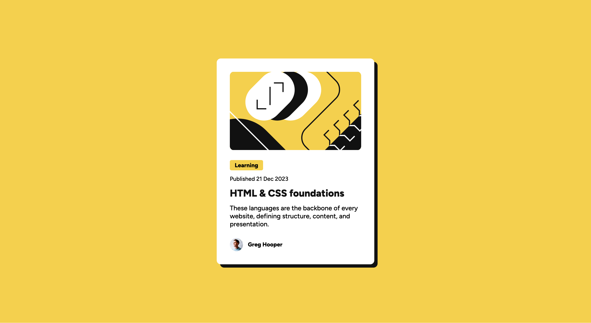

# Frontend Mentor - Blog preview card solution

This is a solution to the [Blog preview card challenge on Frontend Mentor](https://www.frontendmentor.io/challenges/blog-preview-card-ckPaj01IcS). Frontend Mentor challenges help you improve your coding skills by building realistic projects.

## Table of contents

- [Overview](#overview)
  - [The challenge](#the-challenge)
  - [Screenshot](#screenshot)
  - [Links](#links)
- [My process](#my-process)
  - [Built with](#built-with)
  - [AI Collaboration](#ai-collaboration)
- [Author](#author)

## Overview

### The challenge

Users should be able to:

- See hover and focus states for all interactive elements on the page

### Screenshot

### Links

- Solution URL: [https://github.com/alexisborron/blog-preview-card](https://github.com/alexisborron/blog-preview-card)
- Live Site URL: [https://alexisborron.github.io/blog-preview-card](https://alexisborron.github.io/blog-preview-card)

## My process

### Built with

- Semantic HTML5 markup
- CSS custom properties
- Flexbox
- CSS Grid
- Mobile-first workflow
- BEM naming convention

### AI Collaboration

I used Claude to help organize my CSS and to review the page for accessibility issues. It flagged that the yellow hover color on the card link has low contrast against the white background. Since the design specifies that color, I kept it and added a second, non-color cue: an underline in a dark color on hover. That way the hover state is still noticeable for people with low vision or color vision deficiencies.

## Author

- Frontend Mentor - [@alexisborron](https://www.frontendmentor.io/profile/alexisborron)
